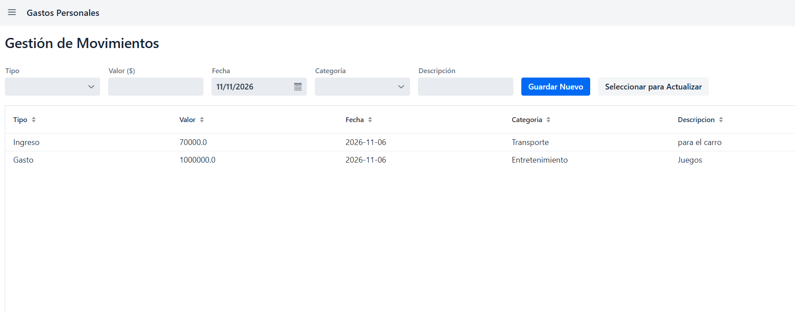
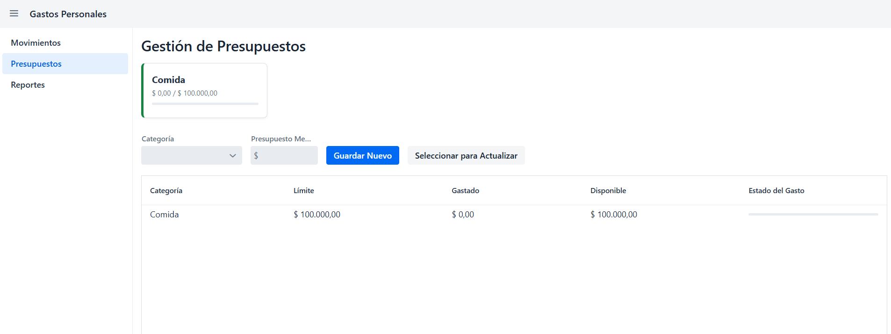

# GastosPersonalesVaadin
Proyecto app digitar para gestion de gastos personales mediante tecnología Vaadin.
Gestor de Gastos Personales
Aplicación web desarrollada en Java utilizando el framework Vaadin y arquitectura basada en archivos de texto plano para la persistencia local de datos. Diseñada para llevar el control detallado de los movimientos financieros (ingresos y gastos) y la gestión de presupuestos mensuales con alertas visuales de progreso.

# Características Principales
Navegación Intuitiva (MainLayout): Menú lateral desplegable para alternar fluidamente entre las distintas secciones del sistema.

Gestión de Movimientos (MovimientosView):

Registro de ingresos y gastos con selección de tipo, valor en moneda local, fecha, categoría y descripción.

Funcionalidad de creación, actualización selectiva y almacenamiento persistente.

Control de Presupuestos (PresupuestosView):

Creación de límites mensuales por categorías (Comida, Transporte, Servicios, etc.).

Tarjetas de resumen visuales con barras de progreso (ProgressBar) dinámicas que cambian de color según el porcentaje consumido del presupuesto.

Interfaz con botones de control integrados (Guardar Nuevo, Seleccionar para Actualizar, Guardar Cambios y Cancelar).

Persistencia Local (ArchivoService):

Almacenamiento independiente en archivos de texto plano (movimientos.txt y presupuestos.txt) separados por tuberías (|), garantizando que los datos no se pierdan al reiniciar la aplicación.

# Tecnologías y Librerías Utilizadas
Java (JDK 17 o superior)

Vaadin Flow (Componentes UI web en Java)

Maven (Gestor de dependencias y construcción del proyecto)

I/O de Java (Scanner, FileWriter, BufferedReader) para la gestión de archivos locales.

# Estructura del Proyecto
Plaintext
src/main/java/com/example/gastospersonales/
│
├── data/
│   ├── ArchivoService.java   # Lógica de lectura y escritura en archivos .txt
│   ├── Movimiento.java       # Modelo de datos para los movimientos
│   └── Presupuesto.java      # Modelo de datos para los presupuestos
│
└── views/
    ├── MainLayout.java       # Estructura principal y barra de navegación lateral
    ├── MovimientosView.java  # Vista de control de ingresos y gastos
    ├── PresupuestosView.java # Vista de control y tarjetas de presupuestos
    └── ReportesView.java     # Vista para reportes y estadísticas generales

    
